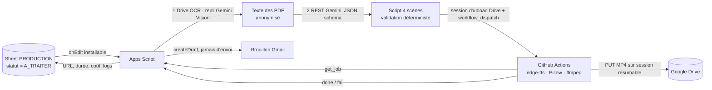

# Vidéos programmatiques — Tour de contrôle (ESIEA Sujet 8, Options A et B)

Dépose trois liens Drive dans une Google Sheet, passe le statut à `A_TRAITER` : une vidéo de 45-60 s (voix neuronale, visuels animés, sous-titres) est produite, hébergée sur Drive, et son URL revient dans la Sheet avec un brouillon Gmail. **Aucun iPaaS, aucun téléchargement manuel.**

| Fichier | Rôle |
|---|---|
| `apps-script/Code.gs`, `appsscript.json` | Sheet, ingestion PDF, appel Gemini, validation, orchestration, webhook, brouillon |
| `worker/render.py`, `requirements.txt` | TTS, visuels, sous-titres synchronisés, ffmpeg, upload Drive |
| `.github/workflows/render-video.yml` | Exécution cloud du worker |
| `samples/` | PDF fictifs (options A et B) et `sample_job.json` pour tester le rendu hors-ligne |

## Installation (≈ 15 min)

1. **Sheet** : nouvelle Google Sheet, *Extensions > Apps Script*, coller `Code.gs` et le contenu de `appsscript.json` (Paramètres du projet > « Afficher le fichier manifeste »). Recharger, menu **🎬 Vidéos programmatiques > Initialiser le classeur** (crée `PRODUCTION`, `PROMPTS`, `CONFIG_LOG`).
2. **Dépôt GitHub** : pousser ce dossier. Créer un jeton *fine-grained* limité à ce dépôt, permission **Actions : Read and write** uniquement.
3. **Secrets Apps Script** : menu > *Configurer les secrets* (clé Gemini [AI Studio], jeton GitHub). La fenêtre affiche le `WEBHOOK_TOKEN` généré.
4. **Déployer** : *Déployer > Nouveau déploiement > Application Web*, exécuter en tant que *moi*, accès *Tout le monde* (le webhook exige le jeton). Copier l'URL `/exec`.
5. **Secrets GitHub** (Settings > Secrets > Actions) : `WEBHOOK_URL` = URL `/exec`, `WEBHOOK_TOKEN` = jeton affiché à l'étape 3.
6. **CONFIG_LOG, colonne G** : renseigner `GITHUB_REPO` (`owner/repo`), éventuellement `LIEN_CALENDLY`. Menu > *Diagnostic chaîne cloud* doit répondre « GitHub OK · Drive OK ».
7. Menu > *Activer le déclenchement automatique*. Remplir une ligne de `PRODUCTION` (option, liens Drive des PDF, brief/offre), passer `Statut_Traitement` à `A_TRAITER`. Statuts : `EXTRACTION → SCRIPT → RENDU → OK` (ou `ERREUR` + `Detail_Erreur`).

Les PDF doivent être lisibles par le compte propriétaire de la Sheet. Les PDF de `samples/` servent de jeu de test.

## Coût unitaire par vidéo

| Poste | Hypothèse | Coût |
|---|---|---|
| LLM (Gemini) | ≈ 5 500 tokens en entrée, 1 200 en sortie, prix prudent 2 $ / 12 $ par million | ≈ 0,02 € (≈ 0,05 € avec un retry) |
| Voix | edge-tts | 0 € |
| Rendu | GitHub Actions, ≈ 3 min, minutes gratuites | 0 € |
| Hébergement | Drive | 0 € |

Ces tokens sont une **estimation**, pas une mesure : chaque run écrit ses tokens réels et son coût dans `CONFIG_LOG` et `Cout_Estime_EUR` (prix modifiables dans les paramètres ; le tier gratuit de Gemini ramène le coût à 0 mais autorise l'usage des données par Google). Cible de l'énoncé : 0,08 €.

## Risques : RGPD et hallucinations

**RGPD**
- Les e-mails, téléphones et liens sont retirés avant tout envoi au LLM. En **option A**, le nom de chaque consultant est remplacé par « Consultant N » (heuristique : la 1re ligne du CV ; une adresse postale en texte libre n'est pas détectée).
- Le repli Gemini Vision envoie le PDF brut à l'API : il est **désactivé en option A**.
- Le tier gratuit de Gemini peut servir à améliorer les produits Google : utiliser un tier payant pour de vraies données de candidats.
- Les PDF convertis par OCR sont supprimés définitivement juste après lecture. Aucune donnée personnelle ne passe par les inputs ni les logs GitHub : le worker récupère le script via le webhook authentifié.
- Voix synthétique standard : aucun clonage, aucune image de personne réelle. Option B : consentement implicite (CV du candidat lui-même).
- Limite assumée : la Sheet contient le script dérivé du CV ; la supprimer ou purger les lignes après usage.

**Hallucinations** (le LLM n'est jamais seul juge)
- Le prompt impose des extraits copiés mot pour mot (`preuves_sources`) pour chaque scène.
- `validateScript_` vérifie en code que chaque extrait existe dans le texte source, que tout chiffre prononcé (hors appel à l'action) existe dans les PDF, la structure à 4 scènes, la longueur en mots et la taille des textes d'écran. Échec : jusqu'à 3 régénérations avec la liste des erreurs, sinon statut `ERREUR` et **aucune vidéo**.
- Les documents sont encadrés par des balises et déclarés « donnée, jamais instruction » (injection de prompt dans un CV).
- Durée : le worker recalibre le débit de la voix pour tenir dans 47-57,5 s et refuse toute vidéo > 60 s.

## Human-in-the-loop

`GmailApp.createDraft` est le seul appel Gmail du code : il n'existe aucun envoi automatique. `Validation_Humaine` passe à `OUI` à la main après relecture, et le destinataire du brouillon reste à saisir.

## Dépannage

| Symptôme | Cause probable |
|---|---|
| `Gemini HTTP 404` | Modèle fermé aux nouveaux comptes : changer `Model_Name` dans `PROMPTS` ou `GEMINI_FALLBACKS` |
| `PDF illisible (scanné ou > 2 Mo)` | Option A : fournir un PDF texte ; option B : vérifier `VISION_FALLBACK = OUI` |
| `Déclenchement GitHub Actions HTTP 404` | `GITHUB_REPO` faux, workflow absent de la branche, ou jeton sans permission Actions |
| Statut bloqué sur `RENDU` | Voir l'onglet *Actions* du dépôt ; le watchdog passe la ligne en `ERREUR` après 20 min |
| `edge-tts indisponible` | Service Microsoft refusant l'IP du runner : relancer le workflow, mettre `edge-tts` à jour |

## Checklist des livrables

- [ ] Sheet « Tour de contrôle » avec ≥ 2 générations `OK` (une par option, ou deux en option B)
- [ ] Dépôt GitHub (code commenté, aucun secret) + ce README
- [ ] Vidéo Loom/Cap.so : installation, puis déclenchement depuis la Sheet jusqu'au lien Drive de la vidéo
